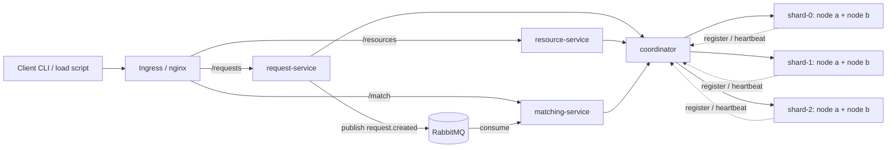

# Implementation Plan — Distributed Emergency Resource Matching System

**Course:** Cloud Computing — Infrastructure Project

**Team:** Pranav Goyal, Aksha Alkesh Jain

**Source of requirements:** `Emergency Response Matching.pdf` (section numbers below, e.g. §8, refer to it)

---

## 1. What we are building

A system where clients submit emergency requests (water, food, medicine, transportation, shelter) and register resources/volunteers. Requests are stored in a sharded, replicated key-value store, published to RabbitMQ, and matched asynchronously to the nearest available resource of the right type. The whole thing runs as containers on Kubernetes and survives a storage node being stopped and restarted.

The five required operations (§1) map onto the seven REST endpoints of §5, which we implement exactly as specified.

| Operation (§1) | Endpoint |
|---|---|
| `createRequest(type, location, details)` | `POST /requests` |
| `registerResource(type, location, availability)` | `POST /resources` |
| `matchRequest(requestId)` | `POST /match/{requestId}`, and automatically through RabbitMQ after `createRequest` |
| `updateStatus(requestId, status)` | `PUT /requests/{id}/status` |
| `getRequest(requestId)` | `GET /requests/{id}` |

## 2. Staying inside the limits (§2)

| Parameter | Requirement | Our design |
|---|---|---|
| Coordinator | 1 | 1 `coordinator` (Deployment, `replicas: 1`, never scaled) |
| Microservices | 2–3 | **3**: `request-service`, `resource-service`, `matching-service` |
| Message broker | 1 RabbitMQ instance | 1 RabbitMQ pod (single-replica StatefulSet), no clustering |
| Storage shards | 3 | 3 shards: `shard-0`, `shard-1`, `shard-2` |
| Replication | ≥ 1 replica per shard | 2 nodes per shard (1 primary + 1 replica) = 6 storage nodes |
| Containerization | Docker, mandatory | One Dockerfile per component, Docker Compose for local dev |
| Orchestration | Kubernetes, mandatory | Minikube, plain YAML manifests |
| Cloud deployment | Optional | Skipped (stretch goal only) |
| Clients | 1 or more | Python CLI + a concurrent load script |

Two things to be careful about so we do not accidentally exceed the limits:

- **No fourth microservice.** There is no hand-written API gateway. The single client-facing entry point is path routing done by infrastructure: a Kubernetes Ingress (and a config-only nginx container in Compose) sending `/requests` → request-service, `/resources` → resource-service, `/match` → matching-service. If the instructor counts an edge proxy as a service, the fallback is to drop it and expose the three services directly — nothing else changes.
- **Coordinator and storage nodes are not microservices.** The spec's table lists them on separate rows, so they sit alongside the 3 microservices rather than counting against them.

## 3. Tech stack

| Concern | Choice | Why (we must be able to justify this, §12) |
|---|---|---|
| Language / framework | Python 3.12 + Flask, served by gunicorn | Both of us know it; small services; fast to iterate |
| Shard storage | SQLite file per storage node, on a persistent volume | Durable, transactional, in the standard library, no extra containers. Six Postgres instances would be heavy and would do the replication for us, which is the part we are meant to build |
| Messaging | RabbitMQ (`-management` image) + `pika` | Mandated; management UI makes the async demo visible |
| Internal RPC | REST/JSON over HTTP (`requests`) | §6 specifies the internal API as REST paths, so we match it |
| Local dev | Docker Compose | One command to boot all ~12 containers; easy `docker stop` for failure tests |
| Orchestration | Minikube | Cross-platform, has ingress and metrics addons |
| Tests | pytest (unit + integration), shell demo scripts | |
| CI | GitHub Actions: ruff + unit tests on every PR | Cheap, and keeps `main` green |

**Changes from the initial idea:**

- **No separate database.** Requests and resources live *in the shards* — §4 requires it. The coordinator holds only cluster membership, in memory, rebuilt from node registrations. So "the database" is the six SQLite files, and there is no other file storage.
- **gRPC: leave out.** The spec gives REST internal endpoints, it adds a build step (protobuf codegen) and a second protocol to debug, and it earns nothing on the demo checklist. Listed under stretch goals.

## 4. Architecture



### 4.1 Components

| Component | Count | Responsibility |
|---|---|---|
| `request-service` | Deployment ×2 | `POST /requests`, `GET /requests/{id}`, `PUT /requests/{id}/status`. Stores the request, then publishes to RabbitMQ |
| `resource-service` | Deployment ×2 | `POST /resources`, `GET /resources`, `PUT /resources/{id}/status` (updates status and/or availability) |
| `matching-service` | Deployment ×2 | Consumes the queue and assigns resources. Also serves `POST /match/{requestId}` (manual/re-match) and runs the sweeper, which re-publishes requests that never reached the queue and repairs leaked claims |
| `coordinator` | Deployment ×1 | Shard routing, node registry, heartbeat monitoring, failover, replication fan-out |
| `storage-node` | 6 × StatefulSet (1 pod each) | Versioned key-value store over SQLite; serves `/internal/data/{key}` |
| `rabbitmq` | StatefulSet ×1 | Async channel between request processing and matching |
| `client` | CLI, runs outside the cluster | Demo and load generation |

The three microservices are stateless, which is what lets Kubernetes scale and replace them freely. All state is in the storage layer.

### 4.2 Data model (§3)

Keys are `request:<uuid>` and `resource:<uuid>`. Values are JSON.

**Request:** `id`, `type`, `location {lat, lon, label}`, `details`, `status`, `created_at`, `updated_at`, `candidate_resource_id`, `match_attempt`, `assigned_resource_id`, `queued`

**Resource:** `id`, `type`, `location {lat, lon, label}`, `availability` (integer: how many requests it can still serve — a volunteer is 1, a water depot might be 50), `status`, `created_at`, `updated_at`, `assigned_request_ids` (a map from each request id to the attempt number that made the claim)

Request status: `PENDING → MATCHED → IN_PROGRESS → COMPLETED`, plus `UNMATCHED` (no resource found after retries) and `CANCELLED`. Illegal transitions return 409. The transition rules live in `common/`, because two services write requests: request-service for client updates, and matching-service for `MATCHED`/`UNMATCHED`, which clients cannot set through the API.
Resource status: `AVAILABLE`, `BUSY` (availability is 0), `OFFLINE` (set manually). Unless a resource is `OFFLINE`, its status is derived from availability, so raising availability on a `BUSY` resource makes it `AVAILABLE`. `PUT /resources/{id}/status` accepts `status` and/or `availability` and writes with compare-and-set, so a manual update cannot overwrite a concurrent claim by the matcher; setting `AVAILABLE` while availability is 0 returns 409. Releasing a request is one compare-and-set that removes its id from `assigned_request_ids` and adds the unit of availability back only if the id was there, so a redelivered release cannot inflate capacity. It returns a `BUSY` resource to `AVAILABLE`; an `OFFLINE` resource stays `OFFLINE`.

### 4.3 Sharding (§4)

`shard = int(md5(key).hexdigest(), 16) % 3`, where `key` is the full storage key (for example `request:<uuid>`) encoded as UTF-8, computed only inside the coordinator. Clients and microservices never see a shard number.

> **Gotcha:** do not use Python's built-in `hash()`. It is salted per process, so two coordinator restarts would route the same key to different shards.

`GET /resources` and the matching query need data from every shard, so the coordinator also offers a scatter-gather scan (`GET /data?prefix=resource:&type=water`) that queries one live node per shard and merges the results. The nodes do the prefix scan; the coordinator applies the `type` filter after merging.

### 4.4 Replication and consistency

- Each shard has a **primary** and a **replica**, assigned by the coordinator.
- **Write:** coordinator → primary (`PUT /internal/data/{key}`). The primary applies it in a SQLite transaction and bumps the key's `version`. The coordinator then forwards the versioned record to the replica on a separate endpoint (`PUT /internal/replica/{key}`), which stores that exact version without bumping it, and only then acknowledges. Replication is synchronous while the replica is up, so an acknowledged write is on both nodes. A replica that already holds that version or a newer one replies 200 with `applied: false` — not an error, so a healthy node is never marked `DOWN` for it.
- **Per-shard write lock:** the coordinator holds one lock per shard around each write (primary plus replica), each role change, and the final sync pass (§4.5). Writes therefore reach both nodes in the same order, and the primary cannot change during the final pass. Heartbeats never take this lock. At demo scale it costs nothing. Because the lock is held across calls to both nodes, every internal HTTP call carries an explicit timeout (about 2 s for node calls; `requests` has none by default), so a node that hangs cannot freeze its shard.
- **Read:** from the primary; on error or timeout the coordinator immediately retries on the replica.
- **Conditional write (compare-and-set):** `PUT /data/{key}` accepts `if_version`. If the stored version differs the node returns 409. This is what stops two matching pods assigning the last unit of the same resource. Records are stored as whole JSON values, so every read-modify-write by any service uses it, including client status updates and the `queued` flag. A version conflict is not a client error: the service re-reads, re-checks the rule and retries a few times, and the client gets 409 only when the transition itself is illegal.
- **Deletes** are tombstones (a `deleted` flag with a version bump) so they propagate during sync. Prefix scans and key counts skip tombstones; the sync digest and replica writes include them.

### 4.5 Failure handling (§8)

| Requirement | Mechanism |
|---|---|
| Detect unavailable nodes | Nodes heartbeat every 2 s. Coordinator marks a node `DOWN` after 6 s of silence, or immediately on a connection error |
| Avoid routing to failed nodes | Coordinator reads only from `UP` nodes and never routes to `DOWN` ones |
| Use an available replica | If the primary is `DOWN`, the replica is promoted to primary — but only if it is in sync (see below). If the primary fails in the middle of a write, the coordinator promotes inside the same locked section (the lock is re-entrant) and retries that write once on the new primary, so writes in flight during a failover succeed instead of returning 503 |
| Continue processing | Writes proceed in degraded mode on the one surviving node. Requests for a shard get 503 only if it has no in-sync node up |
| Synchronize on recovery | Any node coming back from `DOWN` enters `SYNCING` — whether it restarted and re-registered, or never restarted and simply resumed heartbeating. The coordinator then drives the sync from a background thread — never inside the heartbeat or register handler, where a slow pass would delay the reply and flip the node back to `DOWN` — by calling `POST /internal/sync/run` on the node with the primary's URL. In one pass the node fetches the primary's digest `{key: [version, content_hash]}` and overwrites every key that differs. The coordinator runs one pass without the lock to copy the bulk, then a final pass while holding the shard's write lock, in which the node also deletes keys the primary does not have, and only then marks the node `UP` as a replica. While `SYNCING` it receives new writes but serves no reads |

**In-sync set.** Per shard, the coordinator tracks which nodes hold every acknowledged write. A node is removed when it goes `DOWN` while the other node keeps taking writes, and is added back only when its sync completes. Only an in-sync node may be primary. The last member is never removed: if it goes down too, the shard returns 503 until that same node returns, and it then resumes as primary without syncing. This stops a node that missed writes during its own outage from being promoted and silently losing them.

Sync copies the primary exactly instead of comparing versions alone, because two nodes can hold different values at the same version (the old primary commits a write and dies before it is replicated; the new primary reuses that version number). Writes found only on the recovering node were never acknowledged, so discarding them is safe. The final pass runs under the write lock, and only that pass deletes, because an unlocked pass compares against a digest that is already slightly old: it would delete a key created a moment ago, and under steady load it might never come back clean. With writes to the shard paused for that one short pass, the copy is exact.

Known limitation to state honestly in the report: the coordinator is a single point of failure (the spec requires exactly one). Its state is in-memory, so on restart it rebuilds membership from the next round of heartbeats.

### 4.6 Asynchronous matching (§7)

RabbitMQ topology:

- Exchange `emergency` (direct, durable)
- Queue `match.requests` ← routing key `request.created` (durable, persistent messages, manual ack, `prefetch=1`)
- Queue `match.retry` with a message TTL that dead-letters back into `match.requests` — used when no resource is available yet
- Queue `match.released` ← routing key `request.closed`, so a completed or cancelled request frees its resource. The message carries `request_id` and the resource id (the assignment, or the candidate if the request was cancelled mid-match), so the consumer needs no extra lookup
- Queue `match.dead` — dead-letter queue for messages that can never succeed. They are rejected without requeue, so a poison message cannot loop

Flow for `POST /requests`: validate → store as `PENDING` with `queued: false` via coordinator → publish `{request_id, attempt, correlation_id}` → set `queued: true` with a compare-and-set against the version from the first write → return 201. A 409 on that write counts as success: something, usually the matcher, has already moved the request on, and a plain write would have overwritten the match. If the publish fails the API still returns 201 (with `queued: false` in the body), because the request *is* stored — a 503 here would make the client retry and create a duplicate. A sweeper thread in matching-service re-publishes `PENDING` requests that have had `queued: false` for more than 30 s, setting the flag by the same compare-and-set rule; `POST /match/{id}` covers the same case by hand, by matching the request synchronously. The sweeper only looks at unqueued requests, so it does not routinely re-publish messages that are waiting in the queue or in retry. Duplicates can still happen — a publish succeeds and the process dies before the flag is saved, or two pods' sweepers pick up the same request — and are harmless because matching is idempotent.

Matching strategy (type + location, as required):

1. Load the request. If it is not `PENDING`/`UNMATCHED`, ack and stop — redelivered messages must be harmless.
2. If the request already carries a `candidate_resource_id`, an earlier or concurrent attempt has chosen that resource — go to step 4 with it. Otherwise scan resources of the same `type` with status `AVAILABLE` and `availability > 0`.
3. Rank by haversine distance; discard anything beyond `MAX_RADIUS_KM`; tie-break on higher availability, then older registration. Then record the choice before reserving anything: compare-and-set `candidate_resource_id` onto the request, incrementing `match_attempt`. If that write loses, go back to step 1. The request record is the single arbiter, so two workers do not each reserve their own resource.
4. Claim the candidate with a compare-and-set write (decrement `availability`, record the request id with the current attempt number in `assigned_request_ids`), re-reading on 409. If the resource already lists this request id, the claim exists, and the stored attempt number decides what happens: lower than ours → take it over by writing our number, without decrementing again; equal → reuse it as it is; higher → we are the stale worker, so leave the claim alone and go back to step 1. If the resource can no longer take the request, compare-and-set the request's candidate to the next-ranked resource (a new attempt) and repeat.
5. Compare-and-set the request to `MATCHED`, with `assigned_resource_id` set to the candidate. If that loses, re-read the request and decide by its state, never release just because the write lost:
   - still `PENDING`/`UNMATCHED` with the same candidate and the same attempt number (something else, such as the `queued` flag, changed the version) → retry this step;
   - same candidate but a newer attempt number → a later attempt has chosen this resource again; do not finalize or release, go back to step 1;
   - already matched to this resource → another worker finished the job, so do nothing;
   - candidate or assignment now names a different resource, or the request is `COMPLETED`/`CANCELLED` → release our claim, but only if it still carries our attempt number.
6. If there were no candidates, or storage was temporarily unavailable, publish to `match.retry` and wait for the broker's confirm. Mark the request `UNMATCHED` only after `MAX_ATTEMPTS` searches that completed and found no eligible resource; a storage error means availability could not be determined, so it is retried without using up an attempt. Only then ack the original message — acking first would lose the request if the pod died in between. Malformed messages and unexpected exceptions go to `match.dead`.

Recording the choice on the request in step 3 makes a crash anywhere after it recoverable: on redelivery the service finds the candidate and resumes at step 4, where the request id in `assigned_request_ids` tells it whether the claim was already made. It also makes it safe for the queue consumer, a redelivery and a manual `POST /match` to work on the same request at once: they all resume the same candidate, and capacity is released only when the request closes or its candidate moves elsewhere.

The attempt number is a fencing token. It guards all three things a worker can do to a claim: it may take one over only with a higher number, finalize only while both the resource id and the attempt number on the request still match its own, and release only a claim that still carries its own number. Without it, if the candidate went R1 → R2 → R1, a slow cleanup from the first R1 attempt could free the claim the later attempt had just taken over, leaving a `MATCHED` request whose resource is available to someone else.

Claim reconciliation is the sweeper's second job, and the single backstop for capacity that was reserved and never freed: a `request.closed` publish that failed, a crash right after closing a request, a matcher that died before cleaning up, or a request cancelled just before a paused matcher made its claim. It scans resources and, for each claim, reads the request. It releases the claim if the request is `COMPLETED` or `CANCELLED` — even when the request still names that resource — or if an open request now names a different resource (releasing by the claim's attempt number, so a claim that has since been taken over is left alone). It never touches a claim on the resource an open request currently names: that is a matcher between steps 4 and 5, and releasing it would cause the over-assignment we are guarding against. One scan per sweep is cheap at demo scale.

A `MATCH_DELAY_MS` setting (default 0) adds a pause per message. It is a demo aid, presented as one: at about 300 ms the queue depth and the effect of scaling become visible instead of the queue draining in under a second.

### 4.7 API surface

Client-facing endpoints are exactly Table 2 of the spec. Status codes: 201/200 on success, 400 invalid body, 404 unknown id, 409 illegal status transition or closed request, 503 storage unavailable.

`POST /match/{requestId}` returns 200 with the assigned resource on success, and also when the request is already `MATCHED` or `IN_PROGRESS` — it returns the existing assignment, so calling it right after `POST /requests` never fails just because the queue got there first. It returns 200 with `matched: false` (request left unchanged) when nothing suitable is available; 409 only if the request is `COMPLETED` or `CANCELLED`; 404 if it does not exist.

| Layer | Endpoints |
|---|---|
| Services → coordinator | `PUT / GET / DELETE /data/{key}`, `GET /data?prefix=`, `GET /cluster` (shard map, node states, key counts — used in the demo) |
| Nodes → coordinator (Table 3) | `POST /internal/nodes/register`, `POST /internal/nodes/heartbeat` |
| Coordinator → nodes (Table 3) | `PUT / GET / DELETE /internal/data/{key}` |
| Added for replication, scan, sync, demo | `PUT /internal/replica/{key}`, `GET /internal/data?prefix=`, `GET /internal/sync/digest`, `POST /internal/sync/run`, `GET /internal/stats` |
| Every component | `GET /healthz`, `GET /readyz` |

Exact request/response bodies get written down in `docs/API.md` during Phase 0, before any service code. That document is the contract that lets us work in parallel.

### 4.8 Logging and monitoring

JSON logs to stdout from every component, each line carrying a correlation id that travels in the `X-Request-ID` header and inside the RabbitMQ message, so one request can be followed across services with `kubectl logs`. Health and readiness endpoints back the Kubernetes probes. Liveness checks only the process itself; readiness also checks the coordinator, so a coordinator restart takes pods out of rotation instead of getting them killed. Readiness does not check RabbitMQ: request-service must keep accepting requests while the broker is down (§4.6), and an unready pod would be cut off from its Service. `GET /cluster` and the RabbitMQ management UI are the two "dashboards" for the demo.

## 5. Concepts demonstrated

Microservices · asynchronous messaging (queues, acks, retry/dead-lettering) · hash-based sharding · primary–replica replication · failure detection via heartbeats · failover and recovery sync · optimistic concurrency (versions, compare-and-set) and idempotent consumers · scatter-gather queries · containerization · orchestration (Deployments, StatefulSets, Services, probes, scaling, self-healing) · service discovery via Kubernetes DNS · structured logging.

## 6. Repository layout

```
.
├── README.md
├── IMPLEMENTATION_PLAN.md
├── docker-compose.yml
├── Makefile                  # build, up, down, test, k8s-deploy, demo-*
├── common/                   # shared package: models, validation, hashing, logging, storage client
├── coordinator/              # app + Dockerfile
├── storage_node/             # app + Dockerfile
├── services/
│   ├── request_service/
│   ├── resource_service/
│   └── matching_service/
├── client/                   # cli.py, load.py
├── deploy/
│   ├── nginx/                # Compose-only path routing
│   └── k8s/                  # namespace, config, rabbitmq, coordinator, storage/, services/, ingress
├── scripts/                  # one demo script per item in §10
├── tests/
│   ├── unit/
│   └── integration/
├── docs/                     # API.md, DESIGN.md (justifications), DEMO.md, VIVA_NOTES.md
└── .github/workflows/ci.yml
```

## 7. Who does what

The split follows the one clean seam in the architecture — the storage layer versus the application layer — so we can work in parallel without editing the same files. Swap the names if you prefer the other half.

| Area | Owner |
|---|---|
| Storage node, coordinator, sharding, replication, heartbeats, failover, recovery sync | **Pranav** |
| Kubernetes for coordinator + storage (StatefulSets, volumes, probes); storage failure/recovery demo | **Pranav** |
| request-service, resource-service, matching-service, RabbitMQ topology, matching strategy | **Aksha** |
| Kubernetes for microservices, RabbitMQ, Ingress, config/secrets; scaling and pod-recovery demo; client CLI | **Aksha** |
| API contract, `common/` package, Compose, CI, integration tests, README, design report, demo rehearsal | **Both** — each item has one named driver in the roadmap; the other reviews |

Two rules that keep this fair and safe:

- **Every PR is reviewed by the other person before merge.** Both of us must be able to explain any part of the system at the demo, and review is how that happens. At about four merges a day, review is the bottleneck, not coding, so we keep two fixed review slots a day and clear the queue in each.
- **Aksha is not blocked on Pranav.** In Phase 1 the services are built against an in-memory `FakeStorage` that implements the same interface as the real coordinator client. Swapping in the real one is a one-line change.

## 8. Git workflow

- `git init` and push the skeleton on day one. `main` is protected: no direct pushes, PR + one approval required.
- Short-lived branches named `feat/…`, `fix/…`, `test/…`, `docs/…`, `infra/…`. One PR per row in the roadmap below; aim to open and merge within a day.
- Conventional commit messages (`feat(coordinator): route by md5 hash`). Commit whenever a small piece works — several commits per PR, not one.
- **Merge with a merge commit or rebase, not squash**, so the individual commits stay visible in history.
- Each of us commits from our own machine with `git config user.email` set to the address on our GitHub account, otherwise commits will not be attributed on the contribution graph.
- Tag `main` at the end of each phase (`v0.1` … `v1.0`).
- Never commit `.env`, SQLite files, or credentials. RabbitMQ credentials go in a Kubernetes Secret and a git-ignored `.env` with a committed `.env.example`.

## 9. Phased roadmap

The confirmed submission is **Thursday, 19 November 2026**, with implementation, peer reviews, and rehearsal to be complete by **Wednesday, 18 November**. The phase dates below are the original roadmap, not the current delivery schedule. Follow [the readiness checklist](docs/READINESS.md) for the remaining owners, dependencies, and acceptance gates. Every PR still requires the other person's review before merge.

`P` = Pranav, `A` = Aksha. Each row is one PR; the listed commits are the expected minimum. Every row has one driver; the other person reviews.

### Phase 0 — Setup and contracts → tag `v0.1` · Nov 10–11

Done when: `docker compose up` starts every container and each answers `/healthz`.

| PR | Commits | Owner |
|---|---|---|
| `chore/repo-init` | init repo, `.gitignore`, README stub, this plan, `docs/VIVA_NOTES.md` | P |
| `docs/api-contract` | client API bodies + status codes; coordinator and node API; message schema | P |
| `feat/common-lib` | models + validation; status-transition rules; stable hash helper; JSON logger; config from env | A (models, transitions, logging), P (hash, config) |
| `infra/ci` | ruff config; GitHub Actions workflow running lint + unit tests | A |
| `feat/skeleton-storage` | Flask skeleton + Dockerfile for coordinator and storage node | P |
| `feat/skeleton-services` | Flask skeleton + Dockerfile for the three microservices | A |
| `infra/compose` | `docker-compose.yml` with all components, RabbitMQ, nginx routing; Makefile | A |

### Phase 1 — Core path, no replication, no queue → tag `v0.2` · Nov 12–13

Done when: a request and a resource can be created and fetched through the public API, keys are visibly spread over three shards, and the skeleton images run on Minikube.

| PR | Commits | Owner |
|---|---|---|
| `feat/storage-kv` | SQLite schema, WAL mode, one connection per thread; `PUT/GET/DELETE /internal/data/{key}` with versions; tombstones; unit tests | P |
| `feat/storage-cas-scan` | `if_version` conditional write; prefix scan skipping tombstones; `/internal/stats`; tests | P |
| `feat/coordinator-registry` | node register + heartbeat endpoints; in-memory registry; node-side heartbeat loop | P |
| `feat/coordinator-routing` | hash routing; `/data/{key}` API; scatter-gather scan; `/cluster`; tests for shard selection | P |
| `feat/storage-client` | `StorageClient` interface; `FakeStorage`; HTTP implementation; error → 503 mapping | A |
| `feat/request-service` | create; get; status update with transition rules and retry on version conflict; validation + error handlers; tests | A |
| `feat/resource-service` | register; list with filters; status/availability update with compare-and-set; tests | A |
| `feat/client-cli` | CLI commands for all seven endpoints | A |
| `test/e2e-basic` | Compose-based integration test: create/get/update; distribution check | A |
| `infra/k8s-base` | namespace; ConfigMap; Secret template; image build/load targets in Makefile; bare Deployments + Services for the skeleton images, `/healthz` reachable via `port-forward` | P |

`infra/k8s-base` is here, not in Phase 3, on purpose: Kubernetes is mandatory and its problems (image loading, tunnelling, probes) have nothing to do with our code, so we want to hit them now and not two days before the deadline.

### Phase 2 — Two parallel tracks → tag `v0.3` · Nov 14–16

Done when: requests submitted in bulk are matched through RabbitMQ, and stopping any one storage container does not interrupt service. Whoever finishes their track first picks up the other's remaining rows.

**Track S — replication and fault tolerance (Pranav)**

| PR | Commits |
|---|---|
| `feat/replication` | primary/replica roles in the shard map; per-shard re-entrant write lock; timeouts on every node call; synchronous fan-out to `PUT /internal/replica/{key}`; version-guarded apply replying `applied: false` on duplicates |
| `feat/failure-detection` | heartbeat timeout → `DOWN`; skip dead nodes; read fallback to replica on error |
| `feat/failover` | in-sync set per shard; promote only an in-sync replica; retry an in-flight write once on the promoted node; degraded writes; 503 when no in-sync node is up |
| `feat/recovery-sync` | `SYNCING` on any return from `DOWN`; digest endpoint with version + content hash; coordinator-driven exact-copy sync (`/internal/sync/run`) on a background thread, with the final pass under the shard lock and deletes only in that pass; rejoin as replica |
| `test/storage-failure` | integration tests that stop/start containers: read during failure, write during failure, data present after recovery, stale replica not promoted |
| `test/concurrency` | load script (burst and steady-rate modes); checker proving no resource is over-assigned; manual and queued matching of the same request leave exactly one claim |

**Track A — asynchronous matching (Aksha)**

| PR | Commits |
|---|---|
| `feat/mq-topology` | exchange/queue declaration module; connection retry on startup |
| `feat/request-publish` | publish on create with publisher confirms; `queued` flag set by compare-and-set; still 201 when the broker is down |
| `feat/matching-consumer` | consumer loop with manual ack and prefetch; idempotency check; log pika's `redelivered` flag; `MATCH_DELAY_MS` |
| `feat/matching-strategy` | haversine ranking + radius; candidate and attempt number recorded on the request before any claim; compare-and-set claim; request update with state-based handling of a lost write; unit tests, including two workers that rank differently and an old worker whose takeover, finalization and cleanup are each delayed until the same resource is chosen again |
| `feat/match-retry` | retry queue with TTL for no-candidate and storage errors, retry publish confirmed before the original is acked; `UNMATCHED` only after max attempts that found no eligible resource (storage errors do not count); `match.dead` for poison messages |
| `feat/match-endpoint-release` | `POST /match/{requestId}`, idempotent for matched requests; idempotent release on completed/cancelled |
| `feat/match-sweeper` | sweeper thread: re-publish stored-but-unqueued requests; claim reconciliation scan |

### Phase 3 — Kubernetes → tag `v0.4` · Nov 17–18

Done when: `make k8s-deploy` brings the full system up on Minikube and the Phase 2 end-to-end test passes against it.

| PR | Commits | Owner |
|---|---|---|
| `infra/k8s-storage` | coordinator Deployment + Service; six storage StatefulSets with headless Service (`publishNotReadyAddresses: true`) and volume claims; probes | P |
| `infra/k8s-rabbitmq` | RabbitMQ single-replica StatefulSet + Service + volume | A |
| `infra/k8s-services` | three Deployments (`replicas: 2`) + Services; readiness probes (coordinator only, not RabbitMQ), local-only liveness probes; resource requests | A |
| `infra/k8s-ingress` | Ingress path routing; documented `port-forward` fallback | A |
| `fix/k8s-hardening` | graceful shutdown on SIGTERM for HTTP requests; matching consumer drops its RabbitMQ connection on SIGTERM without finishing the message in hand (safe because it is idempotent); `preStop` sleep + termination grace period; startup ordering via readiness + retries | P |

Why **one StatefulSet per storage node** rather than one per shard: Kubernetes restarts a deleted pod within seconds, too fast to show the "during failure" state. With a StatefulSet per node, `kubectl scale statefulset storage-s1-a --replicas=0` keeps exactly that node down for as long as the demo needs, and scaling back to 1 brings it up with its volume intact so the sync is visible.

### Phase 4 — Testing, demo, documentation → tag `v1.0` · Nov 19

The last row, `chore/rehearsal-fixes`, is the one piece that happens on Nov 20.

| PR | Commits | Owner |
|---|---|---|
| `test/k8s-recovery-scaling` | scripts for pod deletion and `kubectl scale` under continuous load; check that `redelivered=true` shows in the logs after a matching pod is deleted; create requests through the Service with RabbitMQ scaled to 0, scale it back, and check they get matched | A |
| `test/k8s-storage-failure` | storage node stop/restart script on Kubernetes with before/during/after output | P |
| `docs/design` | `DESIGN.md`: one justified paragraph per item in §12 (including why matching-service writes to storage directly instead of calling request-service), plus known limitations | P (storage half), A (services half) |
| `docs/demo` | `DEMO.md` runbook; `scripts/demo-*.sh` for each of the nine items | P |
| `docs/readme` | setup, run, test instructions; architecture diagram | A |
| `chore/rehearsal-fixes` | whatever two full dry-runs of the demo turn up | A |

### If we fall behind — cut list

Cut at fixed checkpoints, not one item at a time — with ten days, a late phase needs more than one small cut to recover:

1. Stale-primary mitigation after a coordinator restart (§12) — document it as a limitation.
2. The `match.released` queue — request-service releases the resource synchronously instead. Claim reconciliation still covers a crash in between.
3. Ingress — use `kubectl port-forward`.
4. CI — drop it if it is not green within an hour of starting.

- **`v0.3` not tagged by the end of Nov 16:** cut items 1–2 together.
- **Kubernetes not passing the end-to-end test by the end of Nov 18:** cut item 3, and stop spending any time on CI.

Never cut: replication with recovery sync, the RabbitMQ path, and Kubernetes scaling and recovery. Those are the required demo. The sweeper is not cuttable either: without re-publishing, a request accepted with 201 while the broker was down would sit in `PENDING`, and without claim reconciliation, reserved capacity can leak for good.

## 10. Required demonstration (§10) → how we show it

| Demo item | How | Evidence on screen |
|---|---|---|
| Request creation | CLI `create-request`, then `get-request` | 201 with id, then 200 with the stored record |
| Resource registration | CLI `register-resource`, then `list-resources` | 201, then the resource in the list |
| Resource matching | Create a water request near a water resource. Then create a request for a type with no resource yet, and register one | Status goes `PENDING → MATCHED`, `assigned_resource_id` set, resource availability decremented. The second request waits in `match.retry`, then matches once the resource exists |
| Data distribution | Create ~30 requests, call `GET /cluster` | Key counts on all three shards, same counts on primary and replica |
| Asynchronous processing | Seed one high-availability resource per type, then the load script submits 50 requests at once, with `MATCH_DELAY_MS=300` | All return 201 immediately; queue depth rises then drains in the RabbitMQ UI; matching logs show consumption |
| Storage failure | Scale a shard's **primary** StatefulSet to 0 | `/cluster` shows node `DOWN` and replica promoted; reads and writes for that shard still succeed |
| Node recovery | Scale it back to 1 | Node goes `SYNCING → UP` and returns as the replica (roles have swapped — say so); a key written during the outage is readable directly from the recovered node |
| Kubernetes recovery | `kubectl delete pod` on a request-service pod while load runs. Then, with the steady-rate load keeping a backlog so a message is always in flight, `kubectl delete pod` on a matching-service pod — its consumer does not drain on shutdown, so the message in hand is left unacknowledged | Replacement pods appear; client sees no failed requests; the deleted matcher's unacknowledged message shows up in another pod's log with `redelivered=true` |
| Kubernetes scaling | Seed one high-availability resource per type. Load script sends a steady ~10 requests/s with `MATCH_DELAY_MS=300` (two pods clear about 6–7/s, so a backlog builds), then `kubectl scale deployment matching-service --replicas=4` | Queue depth grows, then shrinks once the new pods are ready (pod names in logs); checker confirms no double assignment |

## 11. Testing (§11) → where each item is covered

| Required test | Covered by |
|---|---|
| Request creation, retrieval, status updates | unit tests on request-service; `test/e2e-basic` |
| Resource registration and availability updates | unit tests on resource-service, including an availability update racing a claim; `test/e2e-basic` |
| Correct resource matching | unit tests on the ranking function (type filter, nearest wins, radius cut-off, none available) |
| Multiple simultaneous requests | `test/concurrency` load script + over-assignment checker |
| RabbitMQ delivery and processing | integration test: seed known resources, publish N, assert each request reaches `MATCHED` with the expected resource and that resource's availability dropped exactly once per request; redelivery test by killing a consumer mid-message |
| Shard selection and distribution | unit test on the hash function (stable, roughly uniform); integration check via `/cluster` |
| Replica availability during failure | `test/storage-failure` |
| Recovery and synchronization | `test/storage-failure` (write during outage, restart, compare digests) |
| Kubernetes pod failure and recovery | `test/k8s-recovery-scaling` |
| Kubernetes scaling | `test/k8s-recovery-scaling` |

## 12. Risks and things that will bite

- **pika is not thread-safe.** Each thread that talks to RabbitMQ needs its own connection. The matching service runs one consumer thread with its own connection beside the HTTP threads; scaling is done with pod replicas, not in-process workers.
- **SQLite and multiple processes.** Run each storage node with a single gunicorn worker (threads are fine) and do the read-check-write of a conditional write inside one `BEGIN IMMEDIATE` transaction, or compare-and-set will not be atomic. Give each thread its own connection and set `PRAGMA journal_mode=WAL` so readers do not block the writer. Keep the file on a named volume, not a host bind mount.
- **One gunicorn worker for the coordinator and matching-service too.** The coordinator's registry is in process memory; with several workers, heartbeats land in different processes and each sees a different cluster. In matching-service, extra workers would each start their own consumer and sweeper.
- **That one worker needs threads.** gunicorn's default worker handles one request at a time, so in the coordinator heartbeats would queue behind slow writes and healthy nodes would be marked `DOWN`. Run the storage nodes and matching-service with `--workers 1 --worker-class gthread --threads 8` and the coordinator with `--threads 32`: heartbeats skip the shard lock but still need a free thread, and writes queued behind one shard's lock could otherwise use them all. Guard the coordinator's registry and shard map with locks.
- **A coordinator restart is expensive.** It wipes the in-memory registry and in-sync set. Give its liveness probe a generous timeout and failure threshold so a slow moment does not get it killed.
- **Storage pods must stay resolvable while not ready.** A headless Service publishes DNS only for ready pods, so the coordinator could not reach a starting or `SYNCING` node by name. Set `publishNotReadyAddresses: true` on the storage Service and keep the storage `/readyz` local (SQLite initialised); the coordinator, not Kubernetes, enforces the no-reads-while-`SYNCING` rule.
- **RabbitMQ needs a stable hostname.** It stores data under its node name, `rabbit@<hostname>`. A Deployment pod gets a new hostname on every restart and so boots with empty queues even with a volume attached — hence the StatefulSet. Same in Compose: set `hostname:` on the service.
- **Startup order.** RabbitMQ and the coordinator may not be ready when services start. Every client connection retries with backoff; readiness probes keep traffic away until the coordinator responds.
- **Images in Minikube.** Locally built images are not visible to the cluster until loaded (`minikube image load …`) and manifests need `imagePullPolicy: IfNotPresent`. On macOS with the Docker driver, Ingress also needs `minikube tunnel` running.
- **Laptop resources.** About 14 pods. Set small CPU/memory requests and start Minikube with at least 4 CPUs and 6 GB.
- **Stale primary after a coordinator restart.** The in-sync set lives in coordinator memory, so if the coordinator restarts while a node is out of date, it could pick the wrong primary. Mitigation: nodes report their highest version when registering and the coordinator waits one heartbeat window before assigning roles. Do this only if time allows; otherwise document it as a limitation.
- **Integration drift between the two halves.** Wire the real coordinator into the services at the end of Phase 1, not at the end of the project.

## 13. Stretch goals (only after `v1.0`)

In rough order of value for effort: HorizontalPodAutoscaler on matching-service · Prometheus metrics endpoint · a small read-only status web page · cloud deployment on a managed Kubernetes service · gRPC for coordinator ↔ storage node.

## 14. Open questions for the instructor

Send these on Nov 10: question 1 decides whether `infra/compose` includes nginx, and that PR is due Nov 11.

1. Does an Ingress or nginx reverse proxy count toward the 2–3 microservice limit?
2. Is the storage-failure demo expected on Kubernetes, or is Docker Compose acceptable for that item? (We plan Kubernetes, with Compose as backup.)
3. What is the demo format (live or recorded), and at what time on Nov 20 is submission due?
